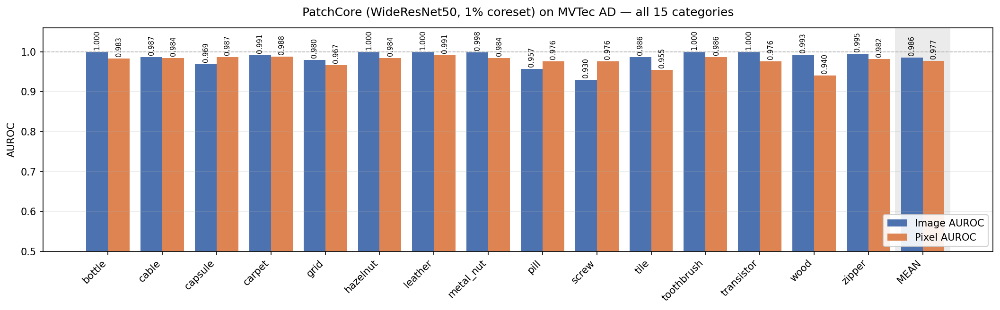

# Unsupervised Industrial Anomaly Detection & Localization

Detect and localize **manufacturing defects from defect-free images only** — no
labelled defects, no fine-tuning, no GPU training required. This repository
implements and benchmarks the two methods that define the state of the art in
training-free industrial inspection — **PatchCore** and **PaDiM** — plus a small
trained autoencoder baseline for contrast, across the **15 categories of MVTec AD**.
Everything runs on free compute (Google Colab T4 / Kaggle GPU).

<p align="center">
  
</p>

---

## Highlights

- **Two training-free detectors + a baseline.** PatchCore (coreset memory bank) and
  PaDiM (per-patch Gaussian) on a frozen ImageNet backbone — no gradient training —
  plus a conv autoencoder to show what the frozen-backbone methods buy you.
- **Detection *and* localization.** Image-level score (defective yes/no) and a
  pixel-level heatmap of *where* the defect is.
- **Honest, reproducible evaluation.** Image AUROC, pixel AUROC, and the PRO score,
  with fixed seeds and one-command runs.
- **Verified on a free Colab T4.** PatchCore reproduces a **0.986 mean image AUROC /
  0.977 pixel AUROC across all 15 categories** end-to-end ([details below](#results)).
- **Clean, typed, tested code.** `src`-layout package, YAML-configured experiments,
  unit tests that need neither the dataset nor a GPU.

---

## Getting started

After cloning, you can be running a benchmark in three commands:

```bash
git clone https://github.com/SHARANcanCODE/industrial-anomaly-detection.git
cd industrial-anomaly-detection
pip install -e .                                   # 1. install the `iad` package

python scripts/download_data.py --root ./data/mvtec_ad   # 2. get the dataset (see "Dataset")

python scripts/run_benchmark.py \                  # 3. run PatchCore on all 15 categories
    --config configs/patchcore.yaml --root ./data/mvtec_ad
```

No GPU or dataset? Verify the install on CPU in seconds:

```bash
pip install -e ".[dev]" && pytest                  # unit tests use synthetic data only
```

Prefer zero local setup? Open
[`notebooks/00_colab_selftest_capsule.ipynb`](notebooks/00_colab_selftest_capsule.ipynb)
in Google Colab, set **Runtime → T4 GPU**, then **Run all**. Full details, more
options, and dataset sources are in [Quickstart](#quickstart) below.

---

## Results

### Full benchmark — PatchCore across all 15 categories (free Colab T4 GPU)

Reproduced end-to-end with this repository's code on a real Tesla T4: training-free
PatchCore (WideResNet50, layers 2+3, **1% coreset**, 224 px) over **all 15 MVTec AD
categories**. Mean **image AUROC 0.986** / **pixel AUROC 0.977** — squarely in the
published PatchCore range, from a memory bank holding just 1 % of patches. Full
notebook: [`notebooks/03_full_benchmark_all_categories.ipynb`](notebooks/03_full_benchmark_all_categories.ipynb).

<p align="center">
  
</p>

| Category | Image | Pixel | | Category | Image | Pixel |
|---|:--:|:--:|:-:|---|:--:|:--:|
| bottle | 1.000 | 0.983 | | pill | 0.957 | 0.976 |
| cable | 0.987 | 0.984 | | screw | 0.930 | 0.976 |
| capsule | 0.969 | 0.987 | | tile | 0.986 | 0.955 |
| carpet | 0.991 | 0.988 | | toothbrush | 1.000 | 0.986 |
| grid | 0.980 | 0.967 | | transistor | 1.000 | 0.976 |
| hazelnut | 1.000 | 0.984 | | wood | 0.993 | 0.940 |
| leather | 1.000 | 0.991 | | zipper | 0.995 | 0.982 |
| metal_nut | 0.998 | 0.984 | | **MEAN** | **0.986** | **0.977** |

The pipeline also produces a 4-panel **heatmap gallery** — each row is
**input · ground-truth mask · anomaly heatmap · overlay** — where the predicted
hotspots overlap the ground-truth defect regions tightly:

<p align="center">
  
</p>

Generate it (writes `results/figures/capsule_patchcore.png`):

```bash
# Fast, CPU-friendly (ResNet18, 1% coreset) — a minute or two:
python scripts/generate_figures.py --config configs/patchcore_fast.yaml \
    --category capsule --root ./data/mvtec_ad

# Full quality (WideResNet50, 10% coreset) — best on a GPU / Colab:
python scripts/generate_figures.py --config configs/patchcore.yaml \
    --category capsule --root ./data/mvtec_ad
```

### Published reference targets (mean over 15 categories)

PatchCore and PaDiM are deterministic given a fixed seed, so a full-benchmark run
