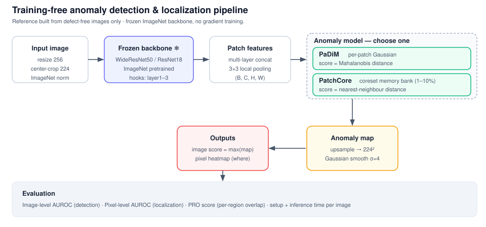
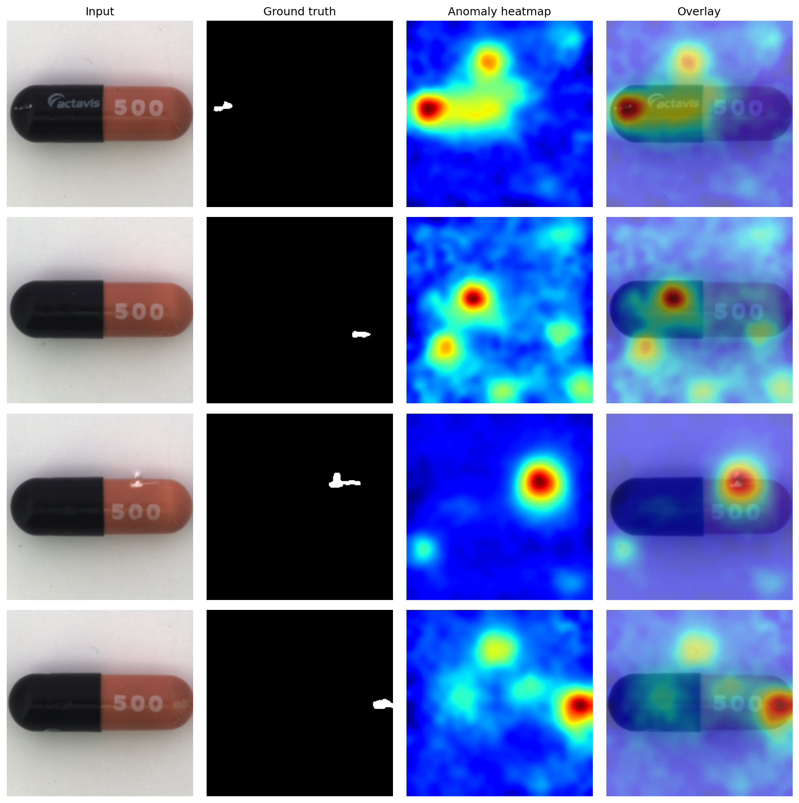

# Unsupervised Industrial Anomaly Detection & Localization

Detect and localize **manufacturing defects from defect-free images only** — no
labelled defects, no fine-tuning, no GPU training required. This repository
implements and benchmarks the two methods that define the state of the art in
training-free industrial inspection — **PatchCore** and **PaDiM** — plus a small
trained autoencoder baseline for contrast, across the **15 categories of MVTec AD**.
Everything runs on free compute (Google Colab T4 / Kaggle GPU).

<p align="center">
  
</p>

---

## Highlights

- **Two training-free detectors + a baseline.** PatchCore (coreset memory bank) and
  PaDiM (per-patch Gaussian) on a frozen ImageNet backbone — no gradient training —
  plus a conv autoencoder to show what the frozen-backbone methods buy you.
- **Detection *and* localization.** Image-level score (defective yes/no) and a
  pixel-level heatmap of *where* the defect is.
- **Honest, reproducible evaluation.** Image AUROC, pixel AUROC, and the PRO score,
  with fixed seeds and one-command runs.
- **Verified on a free Colab T4.** PatchCore reproduces a **0.986 mean image AUROC /
  0.977 pixel AUROC across all 15 categories** end-to-end ([details below](#results)).
- **Clean, typed, tested code.** `src`-layout package, YAML-configured experiments,
  unit tests that need neither the dataset nor a GPU.

---

## Getting started

After cloning, you can be running a benchmark in three commands:

```bash
git clone https://github.com/SHARANcanCODE/industrial-anomaly-detection.git
cd industrial-anomaly-detection
pip install -e .                                   # 1. install the `iad` package

python scripts/download_data.py --root ./data/mvtec_ad   # 2. get the dataset (see "Dataset")

python scripts/run_benchmark.py \                  # 3. run PatchCore on all 15 categories
    --config configs/patchcore.yaml --root ./data/mvtec_ad
```

No GPU or dataset? Verify the install on CPU in seconds:

```bash
pip install -e ".[dev]" && pytest                  # unit tests use synthetic data only
```

Prefer zero local setup? Open
[`notebooks/00_colab_selftest_capsule.ipynb`](notebooks/00_colab_selftest_capsule.ipynb)
in Google Colab, set **Runtime → T4 GPU**, then **Run all**. Full details, more
options, and dataset sources are in [Quickstart](#quickstart) below.

---

## Results

### Full benchmark — PatchCore across all 15 categories (free Colab T4 GPU)

Reproduced end-to-end with this repository's code on a real Tesla T4: training-free
PatchCore (WideResNet50, layers 2+3, **1% coreset**, 224 px) over **all 15 MVTec AD
categories**. Mean **image AUROC 0.986** / **pixel AUROC 0.977** — squarely in the
published PatchCore range, from a memory bank holding just 1 % of patches. Full
notebook: [`notebooks/03_full_benchmark_all_categories.ipynb`](notebooks/03_full_benchmark_all_categories.ipynb).

<p align="center">
  
</p>

| Category | Image | Pixel | | Category | Image | Pixel |
|---|:--:|:--:|:-:|---|:--:|:--:|
| bottle | 1.000 | 0.983 | | pill | 0.957 | 0.976 |
| cable | 0.987 | 0.984 | | screw | 0.930 | 0.976 |
| capsule | 0.969 | 0.987 | | tile | 0.986 | 0.955 |
| carpet | 0.991 | 0.988 | | toothbrush | 1.000 | 0.986 |
| grid | 0.980 | 0.967 | | transistor | 1.000 | 0.976 |
| hazelnut | 1.000 | 0.984 | | wood | 0.993 | 0.940 |
| leather | 1.000 | 0.991 | | zipper | 0.995 | 0.982 |
| metal_nut | 0.998 | 0.984 | | **MEAN** | **0.986** | **0.977** |

The pipeline also produces a 4-panel **heatmap gallery** — each row is
**input · ground-truth mask · anomaly heatmap · overlay** — where the predicted
hotspots overlap the ground-truth defect regions tightly:

<p align="center">
  
</p>

Generate it (writes `results/figures/capsule_patchcore.png`):

```bash
# Fast, CPU-friendly (ResNet18, 1% coreset) — a minute or two:
python scripts/generate_figures.py --config configs/patchcore_fast.yaml \
    --category capsule --root ./data/mvtec_ad

# Full quality (WideResNet50, 10% coreset) — best on a GPU / Colab:
python scripts/generate_figures.py --config configs/patchcore.yaml \
    --category capsule --root ./data/mvtec_ad
```

### Published reference targets (mean over 15 categories)

PatchCore and PaDiM are deterministic given a fixed seed, so a full-benchmark run
with this code should land within the ranges reported in the original papers.
These serve as the expected values when you run `scripts/run_benchmark.py`:

| Method (WideResNet50) | Image AUROC | Pixel AUROC | PRO | Source |
|---|:--:|:--:|:--:|---|
| **PatchCore** (10% coreset) | ≈ 0.991 | ≈ 0.981 | ≈ 0.935 | Roth et al., 2022 |
| **PaDiM** | ≈ 0.955–0.979 | ≈ 0.975 | ≈ 0.921 | Defard et al., 2021 |
| Conv autoencoder (SSIM/L2) | ≈ 0.70–0.85 | ≈ 0.85–0.90 | ≈ 0.70 | Bergmann et al., 2019 |

The chart above is produced from a benchmark run with two commands —
`run_benchmark.py` writes the per-category table to `results/runs/<method>_results.md`
(and `.csv`), and `plot_results.py` turns it into the figure:

```bash
python scripts/run_benchmark.py --config configs/patchcore.yaml --root ./data/mvtec_ad
python scripts/plot_results.py  --csv results/runs/patchcore_results.csv \
    --out results/figures/patchcore_results.png
```

`run_benchmark.py` also reports the PRO score and per-image inference time. (The
default `patchcore.yaml` uses a 10 % coreset and lands a touch higher, near the
published 0.991; the chart above uses 1 % to show how little accuracy that costs.)

---

## Methods

All three methods share a frozen ImageNet backbone for feature extraction; the
first two are completely training-free (no gradient steps at all).

| Method | Reference model | Trains? | Core idea |
|---|---|---|---|
| **PatchCore** | coreset memory bank | no | Store a representative subset of *good* patch features; score a test patch by its nearest-neighbour distance to that bank. |
| **PaDiM** | per-patch Gaussian | no | Fit a multivariate Gaussian per spatial position from good images; score by Mahalanobis distance. |
| **Autoencoder** | conv AE | yes (small) | Learn to reconstruct good images; score by per-pixel reconstruction error. |

**PatchCore** (Roth et al., CVPR 2022) extracts mid-level features (`layer2`,
`layer3`), aggregates each location with its 3×3 neighbourhood, and keeps a
**coreset** — a greedy k-center subsample (1–10%) of all training patches — as a
memory bank. A test patch's anomaly score is its Euclidean distance to the nearest
memory entry; the image score is the (reweighted) maximum patch distance.

**PaDiM** (Defard et al., ICPR 2021) concatenates features from `layer1–3`, keeps a
random subset of channels, and models every patch position with its own Gaussian
`N(μ_ij, Σ_ij)` estimated from the good set. The anomaly score is the Mahalanobis
distance to that position's distribution.

Both produce a coarse patch-level score map that is bilinearly upsampled to the
input resolution and Gaussian-smoothed (σ = 4) to yield the final heatmap.

---

## Why it matters for German manufacturing

Visual quality inspection is one of the highest-value computer-vision problems in
the German industrial base — automotive (Bosch, ZF, Continental), machine tooling,
electronics, pharma and medtech all run high-throughput optical inspection lines.
The constraint on the factory floor is always the same: **defects are rare, diverse
and expensive to label.** You cannot collect thousands of examples of every scratch,
dent, contamination or misprint before a line goes live.

Training-free, unsupervised methods invert the problem — you model only what a *good*
part looks like, of which there is an abundance, and flag anything that deviates.
MVTec AD, released by Munich-based **MVTec Software GmbH**, is the de-facto benchmark
for exactly this setting. This project demonstrates the full pipeline: detection,
pixel-level localization, rigorous evaluation, and the engineering trade-offs that
matter in production (accuracy vs. memory vs. latency).

---

## Repository structure

```
industrial-anomaly-detection/
├── src/iad/                 # installable package (pip install -e .)
│   ├── datasets/            # MVTec AD loader (train = good; test = good + defect + masks)
│   ├── models/              # feature_extractor · patchcore · padim · autoencoder
│   ├── metrics/             # image / pixel AUROC · PRO · evaluate()
│   ├── utils/               # seed · YAML config · gaussian smoothing · coreset sampler
│   ├── visualize/           # heatmap overlays + 4-panel comparison grids
│   └── runner.py            # config -> fitted model -> metrics
├── configs/                 # one YAML per experiment (inherits default.yaml)
├── scripts/                 # download_data · run_benchmark · generate_figures · plot_results
├── notebooks/               # 00 Colab self-test · 01 quickstart · 02 full benchmark
├── tests/                   # unit tests for loaders, metrics, scoring (synthetic data)
├── results/                 # metrics tables + example figures
└── docs/                    # pipeline diagram
```

---
### Dataset

MVTec AD is © MVTec Software GmbH (CC BY-NC-SA 4.0, free for non-commercial use).
MVTec rotated its official download link, so `scripts/download_data.py` now pulls
the dataset from a public, **ungated Hugging Face mirror**
(`TheoM55/mvtec_all_objects_split`, all 15 categories with images, masks and named
defect types) and writes it into the standard MVTec folder layout automatically —
no Hugging Face account or token required:

```bash
python scripts/download_data.py --root ./data/mvtec_ad                 # all 15 (~5.3 GB)
python scripts/download_data.py --root ./data/mvtec_ad --categories capsule bottle
```

On **Kaggle** you can instead add the *MVTec AD* dataset to your notebook and skip
the download by passing `--root /kaggle/input/mvtec-ad` to the benchmark scripts.

---
